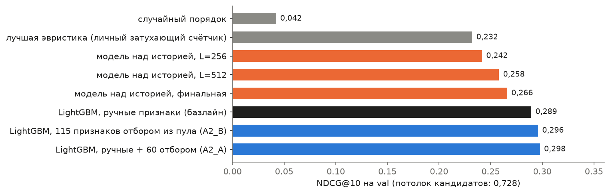
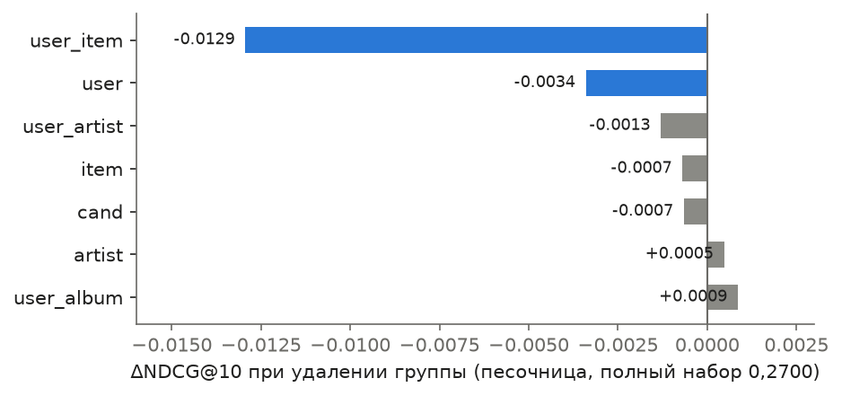
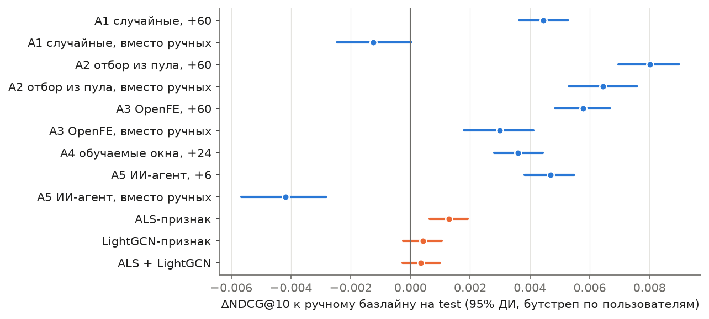
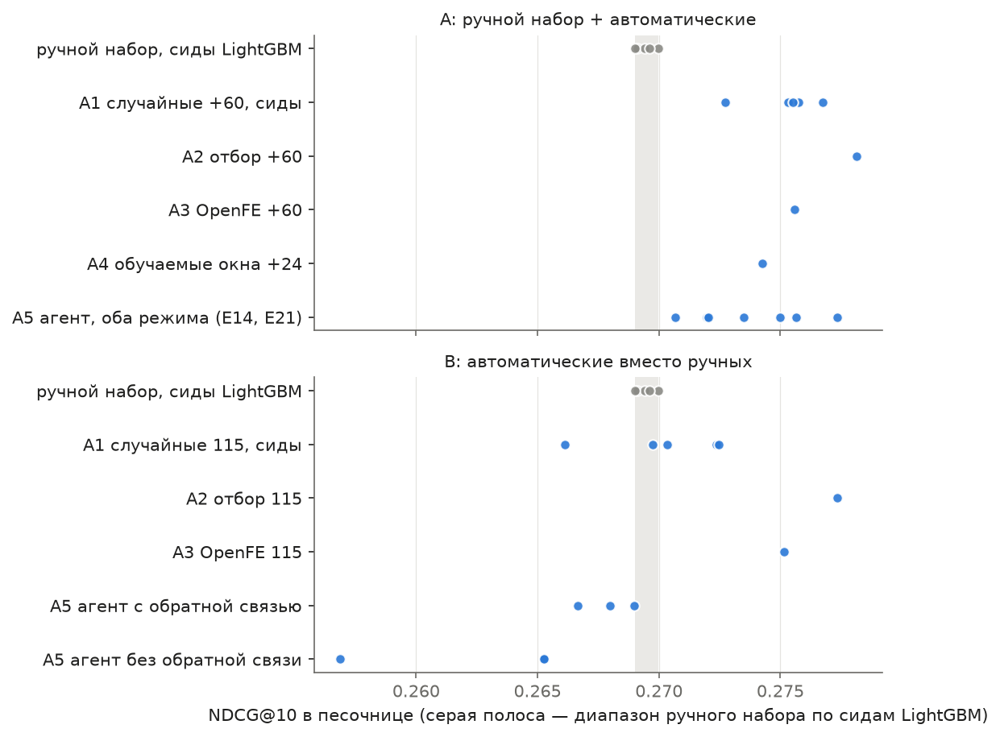
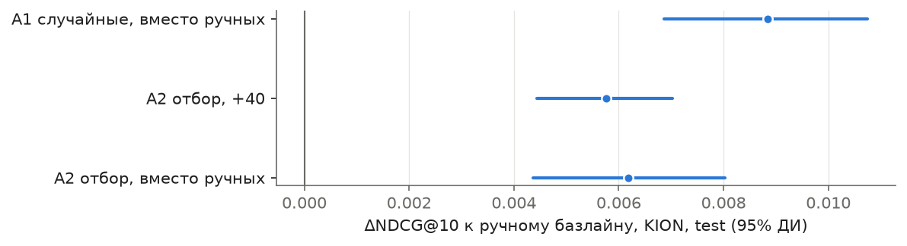
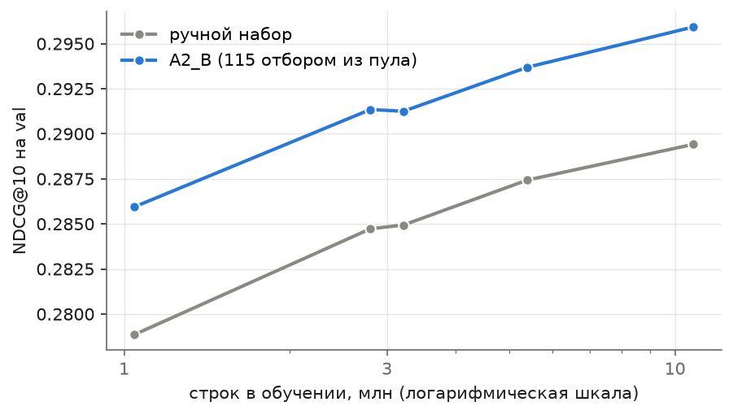

# Можно ли автоматизировать конструирование признаков в рекомендательной системе?

**Градиентный бустинг на ручных признаках против автоматического поиска признаков, графовых и последовательных моделей на Yambda-50M и KION**

Код, результаты всех экспериментов и статья лежат в этом репозитории; каждое число в тексте можно найти в `results.json` соответствующего
эксперимента ([`experiments/`](experiments), сводка длительностей — [`docs/EXPERIMENT_INDEX.md`](docs/EXPERIMENT_INDEX.md)).

**Содержание.** [Аннотация](#аннотация) · [1. Введение](#1-введение) · [2. Связанные работы](#2-связанные-работы) · [3. Данные и аудит](#3-данные-и-аудит) ·
[4. Постановка и протокол](#4-постановка-и-протокол) · [5. Методы](#5-методы) · [6. Результаты](#6-результаты) · [7. Анализ и обсуждение](#7-анализ-и-обсуждение) ·
[8. Ограничения](#8-ограничения) · [9. Заключение](#9-заключение) · [10. Воспроизведение](#10-воспроизведение) · [Источники](#приложение-источники)

## Аннотация

Во многих рекомендательных системах качество определяется бустингом над признаками, которые команда придумывает вручную. Я проверяю, можно ли убрать
человека из этого шага без потери качества: заменить ручные признаки автоматическим поиском, графовыми представлениями или нейросетью над сырой
историей. Основной датасет — Yambda-50M (музыка, 10 тыс. пользователей, 301 сутки), для проверки обобщения — KION (кино). Все методы сравниваются
на одних и тех же кандидатах (около 265 на пару «пользователь — сутки»), при одном глобальном разбиении по времени и одинаковом доступе к информации;
выбор делается на val, test используется только для финальной оценки, доверительные интервалы — бутстреп по пользователям.

Главные результаты (NDCG@10 на 7 отложенных сутках, 30 516 групп; разности — к ручному базлайну, 95% доверительный интервал):

* **Ручной бустинг — сильный базлайн**: 0,289 на val (0,284 на test) против 0,232 у лучшей эвристики (личный затухающий счётчик, val) и 0,042 у случайного порядка; потолок кандидатов — 0,728.
* **Автоматика не хуже человека.** 115 признаков, отобранных из сгенерированного пула по важности (метод A2), *вместо* ручных дают +0,0064 [+0,0053; +0,0076];
  60 таких признаков, добавленные к ручным, — +0,0080 [+0,0070; +0,0090] (+2,8%). Остальные методы — случайный выбор, OpenFE, обучаемые окна, ИИ-агент — слабее A2 значимо
  (парные разности 0,002–0,011), а OpenFE ещё и почти втрое дороже по машинному времени.
* **Выигрыш скромный, и значительная часть его — «просто больше окон».** 60 случайных признаков той же грамматики дают +0,0045; 115 случайных вместо ручных — на уровне ручного
  набора (−0,0012 [−0,0025; 0,0000]). Собственно отбор добавляет +0,0036 в сценарии «добавить» и +0,0077 в сценарии «заменить».
* **Автоматика нашла конкретное.** Отбор сдвигает набор к признакам пары «пользователь — трек» (68% против 28% у ручного), добавляет затухающие счётчики с полупериодами
  1–7 суток (в ручном наборе их нет) и ранги внутри пользователя (17 признаков против 5). Первый по важности признак у всех лучших моделей — ранг счётчика пары за 1–7 суток (12–21% gain).
* **Окна не надо «оптимизировать».** Выбор полупериода по семействам неотличим от шума и от любого фиксированного значения; важен сам факт, что у модели есть несколько масштабов времени.
* **Графовые признаки (ALS, LightGCN) почти бесполезны поверх бустинга:** +0,0013 [+0,0006; +0,0019] и +0,0004 (незначимо): повторное потребление уже хорошо описывают прямые признаки пары.
* **Нейросеть внимания над сырой историей** достигает 92% качества бустинга (0,261 против 0,284 на test; −0,0230 [−0,0247; −0,0213]) и заметно лучше эвристик (0,266 на val против 0,232).
* **ИИ-агент (gpt-oss:120b)** надёжно улучшает готовый набор (7 из 7 запусков в песочнице), но не строит набор с нуля (6 из 6 запусков хуже ручного), а разброс между его запусками в 15 раз больше шума обучения.
* **На KION направление то же** (автоматические наборы лучше ручного на 0,006–0,009), но случайный выбор не хуже отбора: на коротких историях методы поиска не различаются.
* **Преимущество A2_B над ручным набором не зависит от объёма данных** (+0,0063…+0,0071 при росте обучающей выборки в десять раз), а кривые обучения ещё растут.

## 1. Введение

Типичный бустинг-ранкер работает на признаках, придуманных вручную: окна («сколько раз пользователь слушал трек за 7 суток»), связи пользователь — объект,
косвенные связи через артиста или жанр. У такого подхода три слабости: выбор окон и сочетаний произволен («почему именно 7 суток?»), человеческое время дорого,
а часть зависимостей остаётся незамеченной. Вопрос задания — можно ли автоматизировать этот этап **без потери качества**. Я проверяю три направления и
формулирую исследовательские вопросы:

| | вопрос | где отвечаю |
|---|---|---|
| RQ1 | Можно ли заменить ручной набор признаков автоматически подобранным без потери качества? Какой метод поиска лучше и во что он обходится? | 6.3–6.5, 7 |
| RQ2 | Дают ли автоматические признаки прирост *поверх* ручных — и что в нём от отбора, а что от простого увеличения числа признаков? | 6.3, 7 |
| RQ3 | Добавляют ли графовые представления (ALS, LightGCN) информацию, которой нет в агрегатах? | 6.6 |
| RQ4 | Может ли нейросеть над сырой историей заменить ручные агрегаты? | 6.7 |
| RQ5 | Переносятся ли выводы на другой домен (KION)? Как результат зависит от объёма данных? | 6.8, 6.9 |

Что сделано: (а) воспроизводимый конвейер без утечек с автоматической проверкой; (б) единая грамматика, в которой записаны и ручные, и автоматические
признаки, — это делает сравнение методов честным; (в) сравнение методов при равных условиях, включая стоимость и разброс запусков; (г) анализ того, что сработало,
что нет и почему; (д) заранее зафиксированный протокол ([`docs/DESIGN.md`](docs/DESIGN.md)) с журналом изменений.

## 2. Связанные работы

Все источники открыты по первоисточникам; уровень проверки каждого (аннотация или полный текст) указан в [`docs/SOURCES.md`](docs/SOURCES.md).
Утверждения об авторских результатах даются как «авторы заявляют».

**Автоматическое конструирование признаков.** Deep Feature Synthesis (Kanter, Veeramachaneni, 2015) порождает признаки обходом связей
реляционной базы; OneBM (Lam et al., arXiv:1706.00327) автоматизирует соединения таблиц и преобразования; AutoCross (Luo et al.,
arXiv:1904.12857) ищет кросс-признаки лучевым поиском. OpenFE (Zhang et al., ICML 2023, arXiv:2211.12507) оценивает прирост кандидата
дообучением на остатках базовой модели (FeatureBoost) и отсекает кандидатов последовательно; авторы заявляют, что признаки OpenFE с
простой моделью обошли 99,3% и 99,6% команд в двух соревнованиях Kaggle. Языковые модели используются как генераторы признаков в
CAAFE (Hollmann et al., arXiv:2305.03403), LLM-FE (Abhyankar et al., arXiv:2503.14434) и FeatLLM (Han et al., ICML 2024); эти работы
рассматривают табличные данные, а не рекомендательные агрегаты по окнам — прямого аналога для рекомендаций я не нашёл.

**Реляционное глубокое обучение.** Relational Deep Learning (Fey et al., arXiv:2312.04615) и RelBench (Robinson et al.,
arXiv:2407.20060) заменяют ручные признаки графовой нейросетью по базе данных. По данным RelBench специалист тратил около
12,3 часа на задачу, а RDL — около получаса, при том что RDL был не хуже в 11 из 15 задач; авторы оговаривают, что специалист был один, а
в одном случае его признаки допустили утечку. 4DBInfer (Wang et al., arXiv:2404.18209) показывает ограниченность наивных соединений.

**Модели над длинной историей.** DIN (Zhou et al., KDD 2018) строит представление пользователя в зависимости от кандидата; SIM (Pi et al.),
TWIN (Chang et al., KDD 2023) и ETA (Chen et al.) масштабируют это на десятки тысяч событий поиском по истории; SASRec (Kang, McAuley, ICDM
2018) и HSTU (Zhai et al., ICML 2024) моделируют следующее событие; для Яндекс.Музыки описана модель ARGUS (Khrylchenko et al.,
arXiv:2507.15994).

**Графы.** LightGCN (He et al., SIGIR 2020), PinSage (Ying et al., KDD 2018); динамические графы — TGN (Rossi et al.).

**Бустинг и нейросети.** На табличных данных среднего размера деревья остаются сильными (Grinsztajn et al., arXiv:2207.08815), но в
индустриальных рекомендательных задачах с большими данными нейросетевые ранкеры могут быть точнее (ShareChat, arXiv:2312.01760; OTTO,
arXiv:2507.20753). Победители соревнований RecSys Challenge 2020 и OTTO строили двухстадийные системы с бустингом и интенсивным
конструированием признаков, причём для OTTO и Twitter у меня только вторичные источники.

**Методология оценки.** Без глобального разбиения по времени модели «видят будущее» (Ji et al., TOIS 2023, arXiv:2010.11060); способ
разбиения влияет на ранжирование моделей (Meng et al., arXiv:2007.13237); метрики на подвыборке негативов несогласованы с полными
(Krichene, Rendle, KDD 2020); сильные простые базлайны часто превосходят нейросети (Ferrari Dacrema et al., RecSys 2019). Поэтому я
использую глобальное разбиение по времени, ранжирование на общих кандидатах с учётом всех позитивов в знаменателях и сильный ручной базлайн.

## 3. Данные и аудит

До постановки задачи данные проверены отдельными экспериментами ([E01](experiments/E01_audit_yambda), [E02](experiments/E02_audit_kion)).
Аудит выявил расхождения с документацией, которые меняют постановку.

| Находка | Как проверена | Последствие |
|---|---|---|
| Yambda: `timestamp` — **секунды с шагом 5**, а не «5-секундные тики»: при буквальном чтении карточки Hugging Face история длилась бы 1 505 суток, фактически 300,9 | формула в статье; медиана «разрыв до следующего события / длина трека» = 1,0 на 20,6 млн пар | корректная шкала времени |
| Yambda: `is_organic = 1` — органическое действие | у unlike доля organic 94,7%, что согласуется с 5% рекомендательных в Table 2 статьи | фильтры «органика / рекомендации» в грамматике |
| Yambda: **69–73% прослушиваний — повторы** пары (пользователь, трек); 65–73% позитивов следующих суток — повторы | E01 | прямые признаки пары будут сильны; нужна кандидатная стадия |
| Yambda: 63% прослушиваний — Listen+ (доля ≥ 50%): 68% у рекомендательных, 59% у органических | E01 | положительный класс не вырожден |
| KION: отдельный `interactions.csv` в репозитории **обрезан** (ровно 50 МиБ, 1,59 из 5,48 млн строк) | E02 | используется `data_en/interactions.csv` |
| KION: **все пары уникальны**, время — только дата; при повторных просмотрах оставлена последняя запись (статья Petrov et al.) | E02, статья | прямых признаков пары нет; важны косвенные |
| KION: период 13.03–22.08.**2021** (в README ошибочно 2022); у половины пользователей ≤ 2 события | E02 | ручные агрегаты слабее |

**Yambda-50M**: 46,5 млн прослушиваний, 9 238 пользователей с прослушиваниями, 877 тыс. треков, медиана истории 3 024 прослушивания,
48% треков слушали не более двух раз; артист известен для 99,98% событий. **KION**: 5,48 млн взаимодействий, 962 179 пользователей,
15 706 фильмов и сериалов, 44% взаимодействий — просмотр не менее половины. Для KION берётся 10% пользователей (по хэшу id) со **всей**
историей; глобальные признаки (популярность) считаются по всем пользователям.

Самая важная для всей работы находка аудита — доля повторов. Если 70% будущих прослушиваний — треки из истории пользователя, то качество определяется тем,
насколько хорошо признаки описывают «что пользователь слушает сейчас и как давно», а не тем, угадает ли модель новый трек. Это объясняет, почему глобальная
популярность бесполезна (6.1), почему признаки пары доминируют (6.2) и почему графовые представления дают мало (6.6).

## 4. Постановка и протокол

**Задача (Yambda).** В начале суток-якоря `a` для пары (пользователь, кандидат) предсказать, прослушает ли пользователь трек с долей
≥ 50% (Listen+) в окне `[a + 30 мин, a + 30 мин + 24 ч)`. Пауза в 30 минут — как в Global Temporal Split Yambda; признаки используют
только события строго до `a`. В выборку входят (якорь, пользователь) с непустой историей и хотя бы одним позитивом (условная оценка,
как в статье Yambda; сравнение с её таблицей возможно только ориентировочно, там ранжируется весь каталог из 934 тыс. треков).
**Задача (KION).** То же на недельном горизонте: пользователь смотрит фильм в течение следующих 7 суток.

**Глобальное разбиение по времени.** Метки обучающих якорей заканчиваются до первого якоря val, метки val — до первого якоря test
(проверяется кодом, `protocol.check_protocol`).

| часть | Yambda (сутки с начала данных) | KION |
|---|---|---|
| обучение | 150…283 (34 якоря шагом 4, 10,8 млн строк) | якоря ≤ 142, шаг 3 (28 якорей) |
| val | 285…291 (7 суток, 31 688 групп) | якорь 149 (10 430 групп) |
| test | 293…299 (7 суток, 30 516 групп) | якорь 156 (11 088 групп) |

**Кандидаты** общие для всех моделей. Yambda: объединение четырёх источников по истории до `a` — затухающий личный счётчик
Listen+, полный личный счётчик, популярные за 30 суток треки любимых артистов, хиты недели; порядка 265 кандидатов на группу. Состав подобран
по recall на train и val ([E03](experiments/E03_candidate_sweep)): recall растёт почти линейно с числом кандидатов из истории (около +0,001 на
кандидата), «колена» нет, поэтому выбран компромисс между потолком и стоимостью. Потолок recall (доля позитивов, попавших в кандидаты,
[E04](experiments/E04_build_rows)): **0,419 / 0,394 / 0,388** на train / val / test; модель, идеально ранжирующая внутри кандидатов,
получила бы NDCG@10 = 0,728. KION: популярные за 14 суток, популярные в любимых жанрах, item-kNN от последних просмотров; около 248
кандидатов на группу, recall **0,546 / 0,526 / 0,523** ([E30](experiments/E30_kion_rows)).

**Метрики.** NDCG@{10, 100} и Recall@{10, 100} по группам (затем среднее), ROC-AUC и LogLoss по всем строкам. Знаменатели считаются по
**всем** позитивам группы, в том числе не попавшим в кандидаты, поэтому метрики отражают потолок кандидатной стадии. Доверительные
интервалы — парный бутстреп по пользователям (1 000 повторов): пользователь пересэмплируется целиком, так как он даёт несколько групп.
Метрики на подвыборке негативов не используются (Krichene, Rendle, 2020).

### 4.1 Защита от утечек

1. **По построению.** Признак — строка грамматики `ключ.канал.агрегат.окно`; движок читает из посуточных таблиц только сутки до `a`.
   Нельзя «написать неправильно», в том числе для признаков, предложенных языковой моделью: её код не исполняется.
2. **Автоматическая проверка** ([E05](experiments/E05_leakage_tests)). Все события после `a` заменяются случайными, признаки пересчитываются и должны
   совпасть побитово. Результат: **593 признака на трёх якорях — 0 расхождений**. Чувствительность проверки подтверждает «канарейка»:
   признаки, окно которых захватывает сутки якоря, расходятся у 585 из 593.
3. **Векторные модели** обучаются на контрольных точках каждые 7 суток только на событиях до точки; якорь использует модель, обученную до него.
4. **Выбор — на val, оценка — на test.** Поиск признаков идёт в уменьшенной «песочнице» (5.3) на train и val; все обращения к test
   журналируются (`experiments/test_access_log.jsonl`). Подтверждение того, что val не был «переобучен»: разности к базлайну на val и test
   почти совпадают (корреляция 0,998 по 12 наборам; раздел 6.3).
5. **Что фиксировалось заранее.** Протокол, метрики, разбиение, окна ручного набора (1, 7, 30, всё время) и сид случайного контроля (сид 0, а не лучший из пяти) определены
   до запуска сравнений. Изменения протокола записаны в журнале [`docs/DESIGN.md`](docs/DESIGN.md): границы разбиения сдвинуты из-за 30-минутной паузы до обучения моделей,
   позже добавлены масштабирование, стоимость признаков, повторы агента и парные сравнения; постановка, метрики и выбранные наборы не менялись.

## 5. Методы

### 5.1 Ручной набор признаков (базлайн)

123 признака в семи группах: пользователь (27), трек (23), пара пользователь–трек (31), пользователь×артист (20), пользователь×альбом (7),
артист глобально (7), источники кандидатов (8). Окна фиксированы заранее — 1, 7, 30 суток и вся история — и не подбирались по val. Среди
признаков: счётчики и средние по каналам событий, давность, возраст, доли, пять рангов среди кандидатов того же пользователя. Затухающих счётчиков в наборе нет.
Модель — LightGBM, цели lambdarank и binary, 127 листьев, шаг 0,05, ранняя остановка по val; в обучении оставлено 30% негативов (все позитивы).
Гиперпараметры бустинга фиксированы и не подбирались. Для KION — аналогичный набор из 87 признаков без признаков пары (повторов нет).

### 5.2 Грамматика и пул

Признак задаётся строкой `ключ.канал.агрегат.окно`. Ключи: пользователь, трек, пара, пользователь×артист, пользователь×альбом, артист,
альбом. Каналы: любое прослушивание, Listen+ (≥ 50%), пропуск (< 20%), полное (≥ 90%), органическое, рекомендованное, лайки, дизлайки и
их отмены. Агрегаты: счётчик, средняя доля, прослушано секунд, давность, возраст, затухающая сумма (полупериод), число различных
партнёров. Окна: 1…90 суток и вся история. Производные: частное, разность, ранг среди кандидатов пользователя. Полный пул — около 3,6 тыс. признаков;
он включает **все** ручные признаки (проверено), поэтому «ручной набор — подмножество пула». Грамматика нужна не только для перебора, но и для честности:
любой метод (в том числе языковая модель) может предложить лишь допустимую строку, а допустимая строка по построению не заглядывает в будущее.

### 5.3 Методы автоматического поиска (идея 1)

Все методы оцениваются в одной **песочнице**: 20% пользователей, 10 обучающих якорей, 7 val-якорей, lambdarank на 150 деревьев; шум самой
песочницы (разные сиды LightGBM) равен σ ≈ 0,0004 по NDCG@10 (E11). Два сценария: **A** — к ручному набору добавляется 60 признаков;
**B** — набор из 115 автоматических признаков **вместо** ручных (плюс 8 источников кандидатов, которые доступны всем наборам). После выбора в песочнице набор обучается на полных данных.

| метод | суть |
|---|---|
| A1 случайный | случайные признаки пула (контроль: что даёт простое добавление); пять сидов, в финал — заранее зафиксированный сид 0 |
| A2 генерация и отбор | подход в духе Deep Feature Synthesis: считается весь пул, одна модель, отбор по важности (gain) |
| A3 OpenFE | FeatureBoost и последовательное отсечение по долям данных (3,5 тыс. кандидатов → 300, обучающая выборка растёт от 76 до 603 тыс. строк), затем совместная оценка (Zhang et al., разд. 3.2) |
| A4 обучаемые окна | для каждого семейства (ключ, канал) полупериод затухающего счётчика выбирается по приросту |
| A5 ИИ-агент | языковая модель (gpt-oss:120b) предлагает признаки грамматики; режимы с обратной связью (прирост каждого признака) и без неё |

### 5.4 Модель над историей событий (идея 3)

Нейросеть на PyTorch (15,9 млн параметров): вход — последние L прослушиваний пользователя (трек, артист, время до якоря, доля, органика) и кандидат.
Внимание, зависящее от кандидата (в духе DIN/ETA), и обучаемые временные ядра для совпадений по треку и артисту: аналог признаков «число
прослушиваний за окно», где окна ищет сама модель. Агрегатов на входе нет; в финальном варианте добавлены лишь 8 столбцов источников кандидатов
(как и у всех остальных моделей). Варианты: потеря по группе вместо BCE, длина истории L = 256/512, добавление источников кандидатов.

### 5.5 Графовые признаки (идея 2)

LightGCN по графу «пользователь – трек – артист» (рёбра пользователь–трек взвешены затухающим числом прослушиваний) и ALS обучаются на
контрольных точках каждые 7 суток; оценки пар подаются бустингу как дополнительные признаки (гибриды).

## 6. Результаты

Оборудование: Intel Core i5-11400H (6 ядер), 64 ГБ ОЗУ, NVIDIA RTX 3050 Laptop (4 ГБ). Длительности — реальное время по стадиям, берутся из
`results.json`; часть ранних экспериментов (E08, E15 L512 и др.) шла при параллельной нагрузке, и их время завышено (отмечено *).
Суммарное машинное время всех экспериментов — около 15,6 ч.

### 6.1 Эвристики и базовый бустинг ([E06](experiments/E06_heuristics), [E08](experiments/E08_baseline_gbdt))

Val, ранжирование внутри кандидатов (потолок recall 0,394). Recall@100 — среднее по группам.

| ранкер | NDCG@10 | NDCG@100 | Recall@100 | AUC |
|---|---|---|---|---|
| случайный порядок | 0,042 | 0,101 | 0,192 | 0,500 |
| популярность за 7 суток | 0,023 | 0,094 | 0,199 | 0,508 |
| затухающая популярность (полупериод 3 суток) | 0,023 | 0,094 | 0,200 | 0,509 |
| личный счётчик за всё время | 0,123 | 0,182 | 0,283 | 0,696 |
| личный счётчик за 30 суток | 0,199 | 0,243 | 0,332 | 0,751 |
| давность последнего прослушивания | 0,148 | 0,206 | 0,305 | 0,699 |
| личный затухающий счётчик, полупериод 14 суток | 0,218 | 0,257 | 0,342 | 0,768 |
| **личный затухающий счётчик, полупериод 3 суток** | **0,232** | 0,254 | 0,320 | 0,727 |
| *оракул внутри кандидатов* | *0,728* | *0,570* | *0,479* | *1,0* |
| LightGBM lambdarank, 123 ручных признака (E08) | **0,289** | **0,320** | **0,400** | 0,825 |
| LightGBM binary (E08) | 0,288 | 0,319 | 0,399 | **0,845** |

Глобальная популярность практически бесполезна: она не лучше случайного порядка внутри кандидатов, уже отобранных под пользователя. Всё качество
эвристик — повторное потребление. Оптимальное окно зависит от глубины списка: полупериод 3 суток лучше по NDCG@10, 14 суток — по NDCG@100, AUC и
Recall@100 (иллюстрация вопроса «почему именно семь суток»). Бустинг даёт +0,057 NDCG@10 (+25%) к лучшей эвристике. Обучение — 806 итераций,
1 078 с*; lambdarank и binary близки по ранжированию (разница 0,002), binary лучше по AUC и даёт калиброванные вероятности (LogLoss 0,1285). В топе
важности — **ранги внутри пользователя** (`urank(UI.plus.cnt.7)` 17,7% gain, `urank(UI.listen.last.all)` 6,0%), ранг в источнике кандидатов (6,9%)
и счётчик пары за 7 суток (4,9%). Расчёт 123 признаков для 48 якорей — 509 с ([E07](experiments/E07_manual_features), 0,086 с на признак и якорь).



### 6.2 Вклад групп признаков и выбор окон ([E09](experiments/E09_ablation_windows))

Песочница, полный набор — NDCG@10 = 0,2700 (шум σ ≈ 0,0004).



* Почти весь сигнал — в **признаках пары** «пользователь — трек»: без этой группы −0,0129; набор из одних 31 признака пары и 8 источников кандидатов
  (39 признаков) даёт 0,2645, т. е. 98% полного качества. Остальные 84 признака дают вместе около 0,005. Без признаков одного пользователя падение −0,0034, без артиста пользователя −0,0013.
  Удаление признаков альбомов (+0,0009) и глобального артиста (+0,0005) качество не ухудшает. Группы по отдельности без признаков пары слабы: пользователь + кандидаты 0,2264, трек + кандидаты 0,2256, одни кандидаты 0,2225.
* Ручной выбор окон (1, 7, 30) не оптимален: другие тройки дают 0,2654–0,2720, разброс 0,0066 — примерно в 17 раз больше шума. Случайные тройки в среднем хуже ручной
  (≈0,2667), лучшая из проверенных (2, 5, 14) — 0,2720. Сетка из 12 окон (565 признаков) — 0,2737 (+0,0037 к ручному), редкая сетка из 6 окон — 0,2716.
  Размер эффекта выбора окон человеком (±0,003) — того же порядка, что и выигрыш автоматизации в разделе 6.3.

### 6.3 Автоматический поиск признаков: сравнение методов ([E11](experiments/E11_search_random_genselect)–[E14](experiments/E14_search_llm_agent), [E17](experiments/E17_final_A2_B), [E18](experiments/E18test_evaluate_models))

**Финальное сравнение.** Каждый выбранный набор обучен на полных данных (34 якоря, 10,8 млн строк) и один раз оценён на test. Таблица: val — одна
обученная модель на набор (шум обучения на val: два сида ручного набора 0,2894/0,2898, два сида A2_B 0,2959/0,2959); test — NDCG@10 и разность к
ручному набору с 95% доверительным интервалом (бутстреп по пользователям, парный).

| набор | признаков | итераций | val NDCG@10 | val AUC | test NDCG@10 [95% ДИ] | Δ к ручному, val | Δ к ручному, test [95% ДИ] |
|---|---|---|---|---|---|---|---|
| ручной (E08) | 123 | 806 | 0,2894 | 0,8255 | 0,2844 [0,2785; 0,2909] | — | — |
| A1_A случайные, +60 | 183 | 900 | 0,2941 | 0,8291 | 0,2889 [0,2829; 0,2947] | +0,0046 | +0,0045 [+0,0036; +0,0053] |
| A1_B случайные 115 вместо ручных | 123 | 877 | 0,2885 | 0,8263 | 0,2832 [0,2771; 0,2895] | −0,0009 | −0,0012 [−0,0025; +0,0000] |
| **A2_A отбор из пула, +60** | 183 | 635 | **0,2977** | 0,8291 | **0,2924** [0,2863; 0,2989] | +0,0083 | **+0,0080** [+0,0070; +0,0090] |
| A2_B отбор из пула, 115 вместо ручных | 123 | 790 | 0,2959 | 0,8285 | 0,2909 [0,2846; 0,2971] | +0,0065 | +0,0064 [+0,0053; +0,0076] |
| A3_A OpenFE, +60 | 183 | 770 | 0,2954 | 0,8305 | 0,2902 [0,2841; 0,2964] | +0,0060 | +0,0058 [+0,0048; +0,0067] |
| A3_B OpenFE, 115 вместо ручных | 123 | 675 | 0,2927 | 0,8323 | 0,2874 [0,2811; 0,2937] | +0,0033 | +0,0030 [+0,0018; +0,0041] |
| A4 обучаемые окна, +24 | 147 | 880 | 0,2929 | 0,8266 | 0,2880 [0,2819; 0,2943] | +0,0035 | +0,0036 [+0,0028; +0,0044] |
| A5_A ИИ-агент, +6 | 129 | 733 | 0,2940 | 0,8284 | 0,2891 [0,2830; 0,2955] | +0,0046 | +0,0047 [+0,0038; +0,0055] |
| A5_B ИИ-агент, 42 вместо ручных | 50 | 754 | 0,2851 | 0,8184 | 0,2802 [0,2741; 0,2866] | −0,0043 | −0,0042 [−0,0057; −0,0028] |
| H_als, ручной + ALS | 124 | 918 | 0,2902 | 0,8268 | 0,2857 [0,2799; 0,2918] | +0,0008 | +0,0013 [+0,0006; +0,0019] |
| H_gcn, ручной + LightGCN | 125 | 954 | 0,2897 | 0,8269 | 0,2848 [0,2789; 0,2910] | +0,0003 | +0,0004 [−0,0002; +0,0010] |
| H_both, ручной + оба | 126 | 681 | 0,2897 | 0,8267 | 0,2848 [0,2788; 0,2909] | +0,0003 | +0,0004 [−0,0003; +0,0010] |
| модель над историей (E15), L=512 | — | 3 эпохи | 0,2661 | 0,8141 | 0,2614 [0,2555; 0,2673] | −0,0233 | −0,0230 [−0,0247; −0,0213] |

Разности на val и test совпадают с точностью до 0,0005 (корреляция 0,998 по двенадцати наборам, кроме модели над историей): выбор набора в песочнице не «переобучил» val. Сид обучения
меняет val NDCG@10 на 0,0000–0,0004 (ручной 0,2894 → 0,2898, A2_B 0,2959 → 0,2959), т. е. все разности крупнее 0,001 выше шума обучения.



*A* — к ручному набору добавлено до 60 признаков, *B* — автоматические признаки *вместо* ручных (плюс 8 источников кандидатов).

**Остальные метрики на test.** Порядок методов по NDCG@100 и Recall@100 тот же, что по NDCG@10; AUC ведёт себя иначе (у OpenFE выше, чем у A2: 0,832 против 0,828 у вариантов B), т. е. AUC
по всем строкам кандидатов не отражает качество верхушки списка, которое и важно для рекомендаций.

| набор | NDCG@10 | NDCG@100 | Recall@10 | Recall@100 | AUC |
|---|---|---|---|---|---|
| ручной | 0,2844 | 0,3154 | 0,1619 | 0,3952 | 0,8257 |
| A1_A | 0,2889 | 0,3188 | 0,1647 | 0,3978 | 0,8290 |
| A1_B | 0,2832 | 0,3145 | 0,1619 | 0,3935 | 0,8256 |
| A2_A | 0,2924 | 0,3212 | 0,1664 | 0,3994 | 0,8286 |
| A2_B | 0,2909 | 0,3198 | 0,1652 | 0,3977 | 0,8279 |
| A3_A | 0,2902 | 0,3200 | 0,1657 | 0,3983 | 0,8301 |
| A3_B | 0,2874 | 0,3169 | 0,1638 | 0,3946 | 0,8320 |
| A4 | 0,2880 | 0,3177 | 0,1641 | 0,3960 | 0,8270 |
| A5_A | 0,2891 | 0,3185 | 0,1649 | 0,3967 | 0,8287 |
| A5_B | 0,2802 | 0,3109 | 0,1604 | 0,3893 | 0,8187 |
| H_als | 0,2857 | 0,3163 | 0,1625 | 0,3961 | 0,8272 |
| H_gcn | 0,2848 | 0,3158 | 0,1622 | 0,3956 | 0,8272 |
| H_both | 0,2848 | 0,3158 | 0,1617 | 0,3957 | 0,8272 |
| модель над историей | 0,2614 | 0,2963 | 0,1481 | 0,3780 | 0,8121 |

Абсолютные приросты малы потому, что кандидатная стадия и повторное потребление ограничивают то, что может дать ранкер: даже оракул внутри кандидатов даёт Recall@100 лишь 0,479 на val.

**Парные сравнения методов между собой** (test, E18):

| сравнение | ΔNDCG@10 [95% ДИ] | ΔNDCG@100 [95% ДИ] |
|---|---|---|
| A2_A − A1_A (отбор против случайных, +60) | +0,0036 [+0,0027; +0,0044] | +0,0023 [+0,0018; +0,0028] |
| A2_B − A1_B (отбор против случайных, вместо ручных) | +0,0077 [+0,0065; +0,0088] | +0,0053 [+0,0047; +0,0060] |
| A2_A − A3_A (против OpenFE) | +0,0022 [+0,0014; +0,0031] | +0,0012 [+0,0008; +0,0017] |
| A2_B − A3_B | +0,0034 [+0,0025; +0,0045] | +0,0029 [+0,0024; +0,0034] |
| A2_A − A5_A (против ИИ-агента) | +0,0033 [+0,0025; +0,0042] | +0,0026 [+0,0021; +0,0031] |
| A2_B − A5_B | +0,0106 [+0,0093; +0,0120] | +0,0090 [+0,0082; +0,0097] |
| A2_A − A4 (против обучаемых окон) | +0,0044 [+0,0035; +0,0053] | +0,0035 [+0,0030; +0,0040] |
| A2_B − A2_A (заменить ручные против добавить к ним) | −0,0016 [−0,0023; −0,0008] | −0,0013 [−0,0017; −0,0009] |
| A1_B − A1_A | −0,0057 [−0,0068; −0,0046] | −0,0043 [−0,0050; −0,0037] |
| H_als − H_gcn | +0,0009 [+0,0003; +0,0015] | +0,0004 [+0,0001; +0,0008] |

Отбор по важности (A2) значимо лучше всех остальных методов при обоих сценариях. Интервалы учитывают выбор пользователей, но не случайность обучения и выбора набора; для разностей порядка 0,002 это существенная оговорка.
Замена ручного набора на автоматический (B) чуть хуже добавления (A) — на 0,0016 у A2 и на 0,0057 у случайного выбора: по-видимому, ручные признаки содержат то, что случайный набор из 115 признаков пропускает, и добавление страхует от этого.

**Что показывает песочница** (выбор делался в ней). Серая полоса — диапазон ручного набора по сидам LightGBM:



Три наблюдения. (1) Случайные 60 признаков (сценарий A) дают 0,2752 при разбросе 0,2727–0,2767 между сидами выбора — разброс самого выбора в 3–6 раз больше шума
обучения, поэтому один запуск случайного выбора ничего не доказывает; поэтому A1 прогнан на пяти сидах. (2) Случайные 115 признаков вместо ручных (сценарий B) дают
0,2702 (0,2661–0,2725), т. е. столько же, сколько ручной набор (0,2694). (3) Отбор по важности (A2) выше всех случайных запусков: 0,2781 (A) и 0,2773 (B).

**Песочница и полные данные.** Прирост к ручному набору (0,2700 в песочнице) и на test:

| набор | песочница | test |
|---|---|---|
| A2_A | +0,0082 | +0,0080 |
| A2_B | +0,0074 | +0,0064 |
| A3_A | +0,0056 | +0,0058 |
| A5_A (E14) | +0,0050 | +0,0047 |
| A1_A (сид 0) | +0,0058 | +0,0045 |
| A4 | +0,0043 | +0,0036 |
| A3_B | +0,0052 | +0,0030 |
| A1_B (сид 0) | +0,0024 | −0,0012 |

Песочница завышает приросты на 0–0,004: почти не завышает у A2_A, A3_A, A5_A, сильнее всего — у случайных наборов и A3_B; порядок методов в целом сохраняется. Случайная выборка A1_B с сидом 0 в песочнице оказалась
почти лучшей из пяти (0,2724 при максимуме 0,2725), а на полных данных ушла в минус — типичный возврат к среднему; сид был зафиксирован заранее, а не выбран по лучшему результату, поэтому это не «подгонка».

**Стоимость поиска** (машинное время в песочнице; человеческое время не измерялось):

| метод | что считается | время, мин |
|---|---|---|
| A1 случайный | ничего (выбор случайных строк) | ≈ 0 |
| A2 отбор | обучение одной модели на всём пуле и отбор по важности | 9,8 + пул |
| A3 OpenFE | 6,5 тыс. оценок FeatureBoost: 30,9 (сценарий A) и 30,7 (B) | 61,6 + пул |
| A4 обучаемые окна | 288 пробных дообучений на остатках | 2,7 + пул |
| A5 ИИ-агент | 16 обращений к gpt-oss:120b (34 тыс. токенов на входе, 34 тыс. на выходе, 116 с) и оценка предложений: 5,7 (A) и 4,9 (B) | 10,6 |

Пул из 3,6 тыс. признаков на 17 якорях подвыборки считается один раз для A2–A4: 16,9 мин ([E10](experiments/E10_feature_pool)). Итого A2 ≈ 27 мин, A3 ≈ 78 мин.
OpenFE — самый дорогой метод и при этом не лучше A2. Агент дешевле всех по машинному времени (около 10 мин на +0,0047 в сценарии A), но с оговорками раздела 6.4.

**Обучаемые окна (A4, [E13](experiments/E13_learned_windows)).** Для 24 семейств «ключ × канал» выбирался полупериод затухающего счётчика из 12 значений. Приросты
логарифмической потери на val при добавлении семейства лежат в пределах ±2·10⁻⁴, меняют знак от окна к окну и не образуют монотонной зависимости; выбранные значения хаотичны (для `U.listen` — 21 сутки, для
`U.plus` — 3, для `I.like` — 7). Добавление 24 счётчиков с *любым* фиксированным полупериодом (3, 7 или 14 суток) даёт то же самое: 0,2744 / 0,2737 / 0,2748 против 0,2743 для «обученных». Ответ на вопрос «почему 7 суток»: ни почему —
подходит почти любое значение, а выигрыш даёт сам факт добавления затухающих счётчиков (+0,004 в песочнице, +0,0036 на test).

### 6.4 Агент на языковой модели ([E14](experiments/E14_search_llm_agent), [E21](experiments/E21_llm_agent_repeat))

Агент видит описание задачи, грамматику и текущий набор, предлагает признаки; допустимость проверяется разбором грамматики (недопустимых 3–7% предложений, дубликатов 18–20%), код не исполняется. В режиме с обратной связью принимаются признаки с положительным приростом (FeatureBoost), и в промпт возвращается список принятых и
отвергнутых. Сценарий A: 6 принятых признаков из ≈120 предложенных — песочница 0,2750 (+0,0050), на полных данных +0,0047 на test, т. е. столько же, сколько
60 случайных признаков (+0,0045); на признак — в десять раз эффективнее. Среди принятых — `UI.like.decay.h7`, `U.plus_org.cnt.30`, `UI.plus_org.cnt.7`, `UI.plus.decay.h14`, `UI.listen.first.30`, `UI.listen.decay.h30`:
затухающие счётчики пары и разрезы «органика / рекомендации» — то же направление, что нашёл отбор (6.5). Сценарий B: принято 42 признака (набор из 50 вместе с источниками кандидатов) — песочница 0,2690 (ручной 0,2700), на test **−0,0042**
(потеря). Причина, по-видимому, в размере: обратная связь принимает признак только с положительным приростом, и после пятого раунда агент находил по 1–4 новых признака,
так что набор вышел в 2,7 раза меньше, чем у остальных методов (115); при равном размере (A1_B) результат был на уровне ручного.

**Повторы ([E21](experiments/E21_llm_agent_repeat), 30 мин).** Один запуск агента ничего не доказывает: при одном и том же сиде ответы модели различаются (режим без обратной связи, сценарий A:
0,2756 в E14 и 0,2720 при повторе). Поэтому режимы повторены на сидах 0–2 (в песочнице; ручной набор — 0,2700, шум обучения σ ≈ 0,0004). Заодно восстановлен потерянный в E14 ответ
для сценария B (причина — обрыв ответа по лимиту токенов, исправлено разбором и лимитом).

| режим | сценарий A: ручной + агент | сценарий B: агент вместо ручных |
|---|---|---|
| с обратной связью | 0,2750 / 0,2773 / 0,2707 (6 / 12 / 12 признаков) | 0,2690 / 0,2680 / 0,2666 (42 / 39 / 34 признака) |
| без обратной связи | 0,2756 / 0,2720 / 0,2720 / 0,2735 (по 60) | 0,2652 / 0,2569 / 0,2653 (107 / 88 / 115) |
| для сравнения | A1 случайные: 0,2752 (0,2727–0,2767); A2: 0,2781 | A1 случайные: 0,2702 (0,2661–0,2725); A2: 0,2773 |

Выводы. (1) Разброс между запусками агента (до 0,0066 в сценарии A) примерно в 15 раз больше шума обучения: одиночный запуск для сравнения методов недостаточен, и я не делаю выводов о
различии агента и случайного выбора на уровне ±0,002. (2) В сценарии A агент всегда лучше ручного набора (7 из 7 запусков: +0,0007…+0,0073, в среднем +0,004), но на уровне случайных 60 признаков и ниже A2.
(3) В сценарии B агент **ниже ручного набора во всех шести запусках** и ниже средней случайной выборки того же размера; обратная связь помогает (в среднем 0,2679 против 0,2625 без неё), но недостаточно.
Это согласуется с потерей −0,0042 на test. (4) Модель лучше «добавляет» признаки к готовому набору, чем строит набор с нуля: ей нужно знать, какие базовые сигналы уже покрыты.
Затраты: один запуск с обратной связью — 14 обращений, ≈30 тыс. токенов на входе и столько же на выходе, около 2 минут ответов модели.

### 6.5 Что именно нашла автоматика

Состав наборов (без 8 источников кандидатов; в ручном 115 признаков):

| набор | с ключом «пара» UI | затухающие счётчики | ранги внутри пользователя | частные признаков |
|---|---|---|---|---|
| ручной | 32 (28%) | 0 | 5 | 19 |
| A1_B (случайный) | 12 | 28 | 5 | 9 |
| **A2_B (отбор)** | **78 (68%)** | 28 | **17** | 39 |
| A3_B (OpenFE) | 78 (68%) | 22 | 17 | 23 |

Отбор по важности сдвигает набор к признакам пары «пользователь — трек» (68% против 28% у ручного) и добавляет то, чего в ручном наборе нет совсем, — затухающие счётчики с полупериодами 1–7 суток
(первый по важности признак A2_B — `urank(UI.plus.decay.h3)`, 19% gain, дальше `urank(UI.listen.last.all)`, `urank(UI.plus.decay.h7)`, доля различных треков `nuniq/cnt`), — и ранговую нормировку внутри пользователя
(17 признаков против 5). OpenFE отбирает практически тот же состав, а агент в сценарии A выбрал `UI.plus.decay.h7` и родственные: **разные методы приходят к одному ответу**, что повышает доверие к нему.
Случайная выборка содержит всего 12 признаков пары — поэтому A1_B не хуже ручного набора, но и не лучше.

Важность концентрируется в одном признаке: у каждой финальной модели первое место занимает ранг счётчика пары за 1–7 суток — `urank(UI.plus.cnt.7)` у ручного набора (17,7%), `urank(UI.plus.decay.h3)` у A2_B (18,8%),
`urank(UI.plus.decay.h1)` у A3_B (12,4%) и у A1_B (18,5%; случайному набору «повезло» вытянуть именно его), `urank(UI.plus.decay.h7)` у A5_B (21,2%). Это объясняет разброс случайного выбора: исход,
по-видимому, определяется тем, попал ли в набор один из немногих ключевых признаков, а не их числом. Ранг внутри пользователя работает потому, что ранжирование идёт по кандидатам одного пользователя: абсолютное значение счётчика
у разных пользователей несопоставимо (активные против редких), а процентиль среди кандидатов — сопоставим, и модели не нужно учить эту нормировку по деревьям.

### 6.6 Векторные признаки и гибриды ([E16](experiments/E16_embeddings))

ALS и LightGCN обучены на контрольных точках каждые 7 суток (граф: 9 159 пользователей, 318 тыс. треков, 8,1 млн рёбер); число шагов LightGCN выбрано калибровкой на val (150/300/600 шагов дают NDCG@10 как самостоятельный
ранкер 0,038/0,048/0,057; ALS — 0,062; для сравнения личный счётчик — 0,232). Эмбеддинги сами по себе слабы: ALS по AUC 0,605 против 0,83 у бустинга. Оценка пары как признак бустинга: ALS +0,0013 [+0,0006; +0,0019], LightGCN +0,0004
[−0,0002; +0,0010], оба +0,0004 [−0,0003; +0,0010] на test. Эффект только у ALS и крайне мал; ALS чуть лучше LightGCN (+0,0009 [+0,0003; +0,0015]). Объяснение: у большинства позитивов
(65–73%) пара уже встречалась, поэтому прямые счётчики пары покрывают их лучше, а коллаборативный сигнал нужен в основном для новых треков, на которые приходится меньшая доля позитивов.
Затраты: 1,71 ч (калибровка 11 мин, контрольные точки 92 мин) — самый дорогой по времени этап при самом малом эффекте; кроме того, эмбеддинг устаревает до 7 суток к моменту прогноза.

### 6.7 Модель над историей ([E15](experiments/E15_sequence_final))

| вариант | val NDCG@10 | AUC | длительность |
|---|---|---|---|
| история L=256, потеря BCE | 0,242 | 0,767 | 16 мин* |
| L=256, потеря по группе (listwise) | 0,242 (0,246) | 0,734 | 16 мин* |
| L=256 + 8 столбцов источников кандидатов | 0,257 | 0,810 | 10 мин |
| L=512, BCE | 0,258 | 0,791 | 57 мин* |
| **L=512 + источники кандидатов (финальный)** | **0,266** | 0,814 | 11 мин |
| *LightGBM, ручные признаки (E08)* | *0,289* | *0,826* | *18 мин* |

Финальная конфигурация заранее зафиксирована (L=512, источники кандидатов, BCE) и оценена на test: **0,2614** [0,2555; 0,2673] — на 0,0230 [0,0213; 0,0247]
ниже ручного бустинга (−8%) и на 0,034 (val) выше лучшей эвристики. Более длинная история (+0,016) и сигналы источников кандидатов (+0,015) дают прибавки, которые частично перекрываются (вместе +0,024);
замена потери ничего не даёт (listwise: лучшая эпоха 0,246, но к третьей эпохе 0,242). Качество к третьей эпохе ещё росло (0,2585 → 0,2636 → 0,2661) — обучение не сошлось, т. е. оценка консервативна, но на RTX 3050 (4 ГБ) и при
времени эпохи около 3 минут я остановился на трёх эпохах (пик памяти GPU около 2 ГБ). Без источников кандидатов AUC модели (0,77–0,79) заметно ниже, чем у бустинга (0,83); по-видимому, ранги кандидатных
источников несут информацию о том, как кандидат попал в список (давность, личная частота), которую внимание по истории воспроизводит хуже.

### 6.8 KION: перенос ([E31](experiments/E31_kion_baseline), [E32](experiments/E32_kion_search), [E33](experiments/E33_kion_final))

KION отличается: пары уникальны (повторов нет), у половины пользователей ≤ 2 события, и признаки пары не определены. Val: случайный порядок 0,0137, личная жанровая частота 0,0158, жанровое сродство 0,0800,
item-kNN 0,1210, популярность за 14 суток 0,1278, за 7 суток 0,1305, тренд популярности (полупериод 3 суток) 0,1316 — лучшая эвристика; бустинг на 87 ручных признаках **0,1544** (+17%, на Yambda +25%); оракул внутри кандидатов 0,621.
Главный признак — суточная популярность фильма (`I.listen.cnt.1` — 43% gain): в домене без повторов качество определяется «что смотрят сегодня», а не персонально.

| набор | признаков | val NDCG@10 | test NDCG@10 [95% ДИ] | Δ к ручному на test |
|---|---|---|---|---|
| ручной | 87 | 0,1544 | 0,1437 [0,1393; 0,1479] | — |
| A1_B (случайные вместо ручных) | 87 | 0,1560 | 0,1526 [0,1479; 0,1569] | +0,0088 [+0,0069; +0,0107] |
| A2_A (отбор, +40) | 127 | 0,1564 | 0,1495 [0,1450; 0,1540] | +0,0058 [+0,0044; +0,0070] |
| A2_B (отбор вместо ручных) | 87 | 0,1521 | 0,1499 [0,1454; 0,1545] | +0,0062 [+0,0044; +0,0080] |



Направление то же, что на Yambda: автоматические наборы не хуже ручного, на test лучше на 0,006–0,009. Но (1) **на val наборы не упорядочены** (разности к ручному от −0,0023 до +0,0020, у A2_B ниже ручного), а в песочнице случайные 81 признак (0,1530) так же хороши, как отобранные (0,1533), и лучше ручных (0,1504);
(2) на test лучшим оказался *случайный* набор A1_B. Значит, на KION ручной набор слабее случайной выборки из грамматики, а ценность самого отбора показать не удаётся (причину я не исследовал;
возможно, при медианной истории в 2 события выбирать почти нечего). Recall@10 не растёт (разности −0,003…0): улучшается порядок внутри верхушки, а не состав. Падение ручного набора с val на test (−0,0107) больше, чем у автоматических (−0,0022…−0,0069):
либо ручной набор менее устойчив к сдвигу во времени, либо ему не повезло на этой неделе; один якорь val и один якорь test этого не различают.

### 6.9 Масштабирование и стоимость ([E19](experiments/E19_scaling), [E20](experiments/E20_feature_cost))

Val NDCG@10 при разном объёме обучающих данных (ручной набор / A2_B, разница):

| данные | строк в обучении | ручной | A2_B | разница |
|---|---|---|---|---|
| 10% пользователей, 34 якоря | 1,04 млн | 0,2789 | 0,2859 | +0,0071 |
| 30% пользователей, 34 якоря | 3,21 млн | 0,2849 | 0,2912 | +0,0063 |
| 100% пользователей, 9 якорей | 2,80 млн | 0,2847 | 0,2913 | +0,0066 |
| 100% пользователей, 17 якорей | 5,40 млн | 0,2874 | 0,2937 | +0,0063 |
| 100% пользователей, 34 якоря (E17) | 10,8 млн | 0,2894 | 0,2959 | +0,0065 |



Преимущество A2_B над ручным набором **не меняется** в десять раз по объёму данных (+0,0063…0,0071), а кривые обучения ещё растут: рост данных с 3 до 10,8 млн строк даёт
+0,0045 у ручного набора — по величине сопоставимо с выигрышем автоматизации признаков. Поэтому добавить данных и добавить признаков — шаги одного порядка, и первое не отменяет второе.
Количество пользователей и количество якорей взаимозаменяемы: 30% пользователей на 34 якорях и 100% на 9 якорях (3,2 и 2,8 млн строк) дают одинаковое качество (0,2849 и 0,2847).
Обучение A2_B не дороже ручного набора (423 против 585 с на 5,4 млн строк; ранняя остановка у A2_B срабатывает раньше: 635 против 696 итераций, при 123 признаках у обоих).
Стоимость признаков ([E20](experiments/E20_feature_cost), якорь 288, пакетами): агрегаты пользователя — около 0,01 с на признак (число различных треков — 0,16 с), признаки трека, пары, артиста и альбома —
0,1–0,27 с, затухающие суммы по паре и артисту — 0,22–0,24 с; поштучно признак в 2–8 раз дороже, чем в пакете; счётчик пары за всю историю втрое дороже недельного окна и в 6–7 раз дороже суточного. Ручные 123 признака на 48 якорях — 509 с (0,086 с на признак и якорь), 115 отобранных — около 400 с.

## 7. Анализ и обсуждение

### 7.1 Ответы на исследовательские вопросы

**RQ1. Можно ли заменить ручной набор автоматическим без потери качества?** Да, для методов, которые строят широкий пул и отбирают по данным. A2 вместо ручных:
+0,0064 [+0,0053; +0,0076] на test (+2,3%), A3: +0,0030, случайный выбор (A1): −0,0012 (интервал касается нуля — «не хуже»). Не для ИИ-агента с ограниченным числом принятых
признаков: −0,0042 [−0,0057; −0,0028]. Разности на val и test практически совпадают (корреляция 0,998, ранжирование методов то же), так что вывод не объясняется
переобучением выбора на val. Лучший по соотношению цена/качество — A2: ≈27 мин машинного времени и один проход обучения по пулу.

**RQ2. Что в приросте от отбора, а что от «просто больше признаков»?** Добавление 60 *случайных* признаков даёт +0,0045 — больше половины выигрыша A2 (+0,0080) и
почти весь выигрыш A5 (+0,0047) объясняется самим фактом добавления разнообразных окон/каналов (этому соответствует и сетка из 12 окон в E09). Вклад отбора — разность A2 и A1, измеренная парным бутстрепом (таблица парных сравнений в разделе 6.3): A2 − A1 = +0,0036 [+0,0027; +0,0044] при добавлении 60 признаков и +0,0077 [+0,0065; +0,0088] при замене ручного набора. То есть в сценарии «добавить» чуть больше половины
выигрыша — «просто больше признаков», в сценарии «заменить» ручной набор равен случайной выборке, а весь выигрыш — от отбора. Вывод: отбор по важности помогает, но не на порядок, а на 1–3% относительного качества.

**RQ3. Графовые представления.** Практически не добавляют: +0,0013 (ALS), +0,0004 (LightGCN, незначимо). Коллаборативный сигнал уже спрятан в признаках пары и
популярности; кроме того, эмбеддинги на контрольных точках устаревают до 7 суток, а их построение — самый долгий этап (1,7 ч).

**RQ4. Нейросеть над историей.** Не заменяет ручные агрегаты: −0,0230 [−0,0247; −0,0213] (−8%). Но она получила 0,261 без единого инженерного агрегата (только 8 столбцов источников кандидатов), что на 0,03 выше лучшей эвристики,
т. е. значительную часть сигнала она извлекает прямо из сырой истории. Этот разрыв, возможно, частично объясняется недообучением (3 эпохи на ограниченном GPU), и я не пробовал стекинг (скор модели как признак бустинга), который был бы естественным следующим шагом.

**RQ5. Перенос и масштаб.** Направление на KION то же, но домен не различает методы поиска (случайный не хуже отбора), а ручной набор оказался слабее случайного; на Yambda преимущество не зависит от объёма данных (до 10,8 млн строк).

### 7.2 Почему результат именно такой

Объяснения ниже согласуются с данными, но не все проверены отдельными экспериментами; там, где это так, сказано «по-видимому».

* **Сигнал упирается в повторное потребление.** 70% позитивов — повторы, а повторное потребление хорошо описывается несколькими прямыми признаками пары (E09: 39 признаков = 98% качества). Всё, что дают остальные 84 признака ручного набора,
  вместе — около 0,005. Автоматизация находит оставшиеся резервы: более мелкие масштабы времени (полупериоды 1–7 суток вместо окон 7/30 суток) и ранговую нормировку внутри пользователя.
* **Почему ранги.** Ранжирование идёт внутри пользователя, поэтому важна относительная сила кандидата среди своих же кандидатов, а не абсолютное число прослушиваний. Процентиль среди кандидатов одного пользователя снимает разницу между
  активными и редкими пользователями; деревьям не приходится выучивать её по другим признакам. В ручном наборе такие ранги были (5 штук) и сразу оказались на первом месте по важности, в отобранном A2_B их 17.
* **Почему мало добавок от «умных» методов.** Важность концентрируется в немногих признаках (первый — 12–21% gain у каждой модели). Если набор уже содержит близкие к ним признаки, остальное — доли процента. Поэтому A1 с
  60 случайными признаками получает +0,0045 (по-видимому, среди них оказались родственные ключевым), а OpenFE за втрое большую цену — меньше, чем простой отбор по важности: его оценка «прироста на остатках» дорога и не точнее, чем gain полной модели.
* **Почему обучаемые окна бессмысленны.** Прирост от добавления семейства не зависит от полупериода в пределах шума, значит поверхность «качество — окно» плоская; ценность — в самом наличии нескольких масштабов.
* **Почему агент хорош в A и плох в B (по-видимому).** Для добавления нескольких признаков к готовому набору достаточно общей идеи («счётчик пары с затуханием»), которую модель знает. Для построения набора с нуля надо покрыть много разнородных сигналов
  (пользователь, трек, артист, альбом, органика, ранги), а обратная связь «прирост > 0» отсекает признаки, чей вклад проявляется только в сочетании с другими.
* **Почему графовые признаки не помогают.** Они описывают общий вкус и помогают на новых треках; позитивы — преимущественно повторы. К тому же эмбеддинг устаревает до недели, а признаки пары обновляются ежесуточно.
* **Почему нейросеть уступает (по-видимому).** Она получает те же события, но должна заново изобрести нормировки и ранги; три эпохи на малом GPU — мало (качество росло до последней эпохи). Заранее вычисленные агрегаты и ранги — это разумное индуктивное смещение,
  которое бустинг получает бесплатно.

### 7.3 Насколько можно доверять выводам

| источник неопределённости | величина | какие выводы затрагивает |
|---|---|---|
| сид LightGBM в песочнице | σ ≈ 0,0004 | любые различия песочницы меньше 0,001 |
| сид обучения на полных данных | ≤ 0,0004 (две пары на val) | различия на test меньше 0,001 |
| разброс случайного выбора признаков | 0,0013 (A) и 0,0023 (B) в песочнице | единичное сравнение случайного набора с чем-либо |
| разброс запусков ИИ-агента | до 0,0066 в песочнице | вывод о месте агента среди методов |
| доверительный интервал разности на test | полуширина ≈ 0,001 (для одной разности) | пары методов с разницей < 0,002 |
| переход песочница → полные данные | завышение на 0…0,004, сильнее всего у случайных наборов и A3_B | абсолютные приросты из песочницы |

Что устойчиво: (1) A2 лучше ручного набора и всех остальных методов (интервалы парных разностей не содержат нуля, порядок один и тот же на val и test, на всех объёмах данных); (2) случайные признаки не хуже ручных; (3) эмбеддинги почти не помогают;
(4) нейросеть уступает бустингу. Что неустойчиво: место ИИ-агента среди методов, различие между A3 и A5_A (≈0,001), эффект LightGCN (в пределах интервала), всё, что связано с KION при одном якоре val и одном якоре test.

### 7.4 Практические рекомендации

1. Если нужен рабочий конвейер: задайте грамматику окон × каналов × агрегатов и относительных преобразований (частные, ранги внутри пользователя), посчитайте весь пул на подвыборке, обучите одну модель и возьмите топ по важности: +2–3% при стоимости около получаса.
2. Не тратьте время на подбор «правильного» окна: набор окон лучше одного окна; выбор между (1, 7, 30) и (2, 5, 14) даёт ±0,003, а набор из 12 окон — больше.
3. Добавляйте автоматические признаки к ручным, а не заменяйте: добавление чуть надёжнее (A2_A лучше A2_B на 0,0016, а случайный выбор в режиме замены уже проигрывает на 0,0057).
4. OpenFE и обучаемые окна не окупились: OpenFE втрое дороже при меньшем эффекте, а эффект обучаемых окон неотличим от шума.
5. ИИ-агент годится как дешёвый источник нескольких признаков поверх готового набора, но его результат нестабилен между запусками — проверяйте в песочнице и не используйте как единственный источник.
6. Не ждите многого от графовых эмбеддингов, когда в данных много повторов; сначала проверьте долю повторов (в этой работе — 70%).
7. Прежде чем усложнять модель, добавьте данные: рост обучающей выборки в три раза даёт прирост, сопоставимый с выигрышем автоматизации признаков.

## 8. Ограничения

* Yambda-50M — 1% пользователей; перенос на миллионы пользователей проверяется лишь масштабированием по числу пользователей (E19, до 100% моих 10 тыс.).
* Оценка условна по пользователям, активным в окне метки (как в протоколе Yambda); абсолютные числа несопоставимы с таблицей статьи, где ранжируется весь каталог.
* Прежняя система рекомендаций Яндекс.Музыки влияет на данные (около половины прослушиваний рекомендательные): модель частично учит политику показа.
* Один временной интервал (301 сутки), сезонность не охвачена; test — семь суток.
* Ручной набор составлен до запуска автоматических методов, окна зафиксированы заранее, но независимого эксперта по рекомендациям в эксперименте не было; другой набор мог бы быть сильнее. Проверка в E09 показывает, что выбор окон человеком даёт разброс ±0,003.
* Гиперпараметры бустинга не подбирались (зафиксированы заранее); подбор мог бы поднять все наборы, порядок методов при этом не проверялся.
* Финальные модели обучены один раз (один сид); шум обучения на val оценён на двух парах (≤ 0,0004), доверительные интервалы на test учитывают выборку пользователей, но не сид.
* Отбор признаков идёт в уменьшенной песочнице (20% пользователей, 150 деревьев); приросты, различающиеся на 0,001–0,002, песочница не разрешает.
* ИИ-агент — внешний сервис: воспроизводимость ограничена версией модели и недетерминизмом (E14 и E21 при одном сиде дают разные ответы); промпты и ответы сохранены. На полных данных и на test оценён только набор из первого запуска (E14); по E21 разброс агента между запусками в песочнице достигает 0,0066, поэтому его место в рейтинге методов определено неточно.
* Модель над историей не доучена; стекинг с бустингом не проверялся. Графовые признаки получены на контрольных точках (до 7 суток устаревания).
* KION: один якорь val и один якорь test, 10% пользователей; различия методов на val неотличимы от шума.
* Часть таймингов получена при параллельной нагрузке на машину (отмечено звёздочкой).

## 9. Заключение

Конструирование признаков в рекомендательной системе можно автоматизировать без потери качества, но выигрыш скромный. На Yambda бустинг по 115 признакам, отобранным из
сгенерированного пула, обходит ручной набор на 0,0064 NDCG@10 (+2,3%), а 60 добавленных к ручному набору признаков дают +0,0080 (+2,8%); доверительные интервалы этих разностей лежат целиком выше нуля, а порядок методов
совпадает на val и test и не меняется при росте обучающей выборки в десять раз.

Откуда берётся выигрыш. В сценарии «добавить» чуть больше половины выигрыша — от самого факта добавления признаков (+0,0045 из +0,0080 дают случайные признаки той же грамматики), остальное — от отбора (+0,0036); в сценарии «заменить» 115 случайных признаков работают
не лучше 115 ручных, и весь выигрыш (+0,0077 к случайным) — от отбора. Содержательно автоматика находит две вещи, которых нет в ручном наборе: затухающие счётчики пары «пользователь — трек» с короткими полупериодами (1–7 суток) и ранговую нормировку внутри пользователя;
эти признаки возглавляют важность у всех лучших моделей, и к ним независимо приходят отбор по важности, OpenFE и ИИ-агент. Данные объясняют, почему так: 70% позитивов — повторы, и единственный резерв — тонко описать «насколько сильно и как недавно».

Что не сработало и почему. OpenFE втрое дороже и значимо слабее простого отбора. Обучаемые окна неотличимы от любого фиксированного значения: поверхность «качество — окно» плоская, важен набор масштабов, а не их точное значение.
Графовые признаки (ALS, LightGCN) добавляют не больше 0,0013 при самых больших затратах: коллаборативный сигнал слабо нужен там, где позитивы — повторы. ИИ-агент надёжно улучшает готовый набор, но не способен построить набор с нуля
(−0,0042) и нестабилен между запусками. Нейросеть внимания над сырой историей достигает 92% качества бустинга (0,261 против 0,284) без единого инженерного агрегата, но не заменяет его: по-видимому, ей не хватает готовых нормировок и более долгого обучения.

Перенос. На KION (короткие истории, нет повторов) направление то же: автоматические наборы лучше ручного на 0,006–0,009, но ценность отбора неотличима от шума — случайный набор не хуже. Вывод «отбор лучше случайного» поэтому, по-видимому, относится к
доменам с богатой историей и сильными прямыми признаками; для доменов с короткими историями преимущество автоматизации сводится к покрытию широкого набора окон и каналов.

Практический вывод: хорошая грамматика признаков и дешёвый отбор по важности важнее «умного» поиска; большая часть пользы — от разнообразия масштабов времени и ранговой нормировки внутри пользователя; на данных такого размера добавление данных
даёт прирост того же порядка, что и автоматизация признаков. Что осталось за рамками: стекинг скора нейросети с бустингом, подбор гиперпараметров бустинга, дообучение нейросети до сходимости, несколько запусков финальных моделей и ИИ-агента на полных данных, оценка на полном каталоге и на всех пользователях Yambda.

## 10. Воспроизведение

Python 3.11, Windows или Linux; для модели над историей и LightGCN нужен GPU с CUDA (проверено на RTX 3050, 4 ГБ). ОЗУ — около 32 ГБ (пик 35 ГБ у отдельных экспериментов), диск — около 60 ГБ (кэш признаков).

```bash
python -m venv .venv
.venv\Scripts\activate                       # Linux: source .venv/bin/activate
pip install torch --index-url https://download.pytorch.org/whl/cu128
pip install -r requirements.txt
pip install -e .
python scripts/00_prepare_data.py            # скачивание и подготовка данных (около 0,5 ГБ)
python scripts/run_pipeline.py --list        # этапы с оценкой времени и состоянием
python scripts/run_pipeline.py --group core  # основные эксперименты, затем: --group extended
python scripts/98_make_figures.py            # рисунки статьи; python scripts/99_make_index.py — индекс экспериментов
```

Эксперименты запускаются по очереди, по одному: параллельные запуски искажают замеры времени и перегружают компьютер. Выполненные этапы пропускаются (`--force` — пересчитать,
`--only 08,17-A2_B` — выбрать этапы). Переменные окружения: `RECSYS_THREADS` (потоки LightGBM, по умолчанию 8), `OLLAMA_API_KEY`, `OLLAMA_API_KEY2` (ключи Ollama Cloud для E14 и E21; при исчерпании лимита — второй
ключ, затем локальный сервер LM Studio: `RECSYS_LOCAL_URL`, `RECSYS_LOCAL_MODEL`).

```
src/recsys/          библиотека: данные, протокол, кандидаты, признаки, модели, поиск признаков, метрики
scripts/             по одному скрипту на эксперимент; номер скрипта = номер эксперимента
experiments/         результаты: config.json, results.json, log.txt, env.json, README.md каждого эксперимента
docs/                SOURCES.md (источники), DESIGN.md (протокол, зафиксированный до запусков), ARCHITECTURE.md, EXPERIMENT_INDEX.md, figures/
```

Список экспериментов: E01–E02 аудит; E03–E04 кандидаты и метки; E05 утечки; E06 эвристики; E07–E08 ручные признаки и базлайн; E09 аблация и окна; E10–E14 и E21 поиск признаков;
E15 модель над историей; E16 ALS и LightGCN; E17–E18 финальные модели и оценка (оценка на test повторена в E18 после добавления парных сравнений — модели те же, выбор не менялся);
E19–E20 масштабирование и стоимость; E30–E33 KION. Версия кода каждого запуска записана в `experiments/*/env.json`; протокол, зафиксированный до основных экспериментов, — [`docs/DESIGN.md`](docs/DESIGN.md) (с журналом изменений).

## Приложение. Источники

Полный список с уровнем проверки каждого — [`docs/SOURCES.md`](docs/SOURCES.md). Основные:

* Ploshkin et al. Yambda-5B. arXiv:2505.22238 · Petrov et al. MTS Kion Implicit Contextualised Sequential Dataset. arXiv:2209.00325
* Kanter, Veeramachaneni. Deep Feature Synthesis. DSAA 2015 · Lam et al. OneBM. arXiv:1706.00327 · Luo et al. AutoCross. arXiv:1904.12857
* Zhang et al. OpenFE. arXiv:2211.12507 · Hollmann et al. CAAFE. arXiv:2305.03403 · Abhyankar et al. LLM-FE. arXiv:2503.14434 · Han et al. FeatLLM. arXiv:2404.09491
* Fey et al. Relational Deep Learning. arXiv:2312.04615 · Robinson et al. RelBench. arXiv:2407.20060 · Wang et al. 4DBInfer. arXiv:2404.18209
* Zhou et al. DIN. arXiv:1706.06978 · Pi et al. SIM. arXiv:2006.05639 · Chang et al. TWIN. arXiv:2302.02352 · Chen et al. ETA. arXiv:2108.04468
* Kang, McAuley. SASRec. arXiv:1808.09781 · Zhai et al. HSTU. arXiv:2402.17152 · Khrylchenko et al. ARGUS. arXiv:2507.15994
* He et al. LightGCN. arXiv:2002.02126 · Ying et al. PinSage. arXiv:1806.01973 · Rossi et al. TGN. arXiv:2006.10637
* Grinsztajn et al. Why do tree-based models still outperform deep learning on tabular data. arXiv:2207.08815 · Jeunen et al. arXiv:2312.01760 · Lutz et al. arXiv:2507.20753
* Ji et al. Data leakage in recommender offline evaluation. arXiv:2010.11060 · Meng et al. arXiv:2007.13237 · Krichene, Rendle. KDD 2020 · Ferrari Dacrema et al. arXiv:1907.06902
